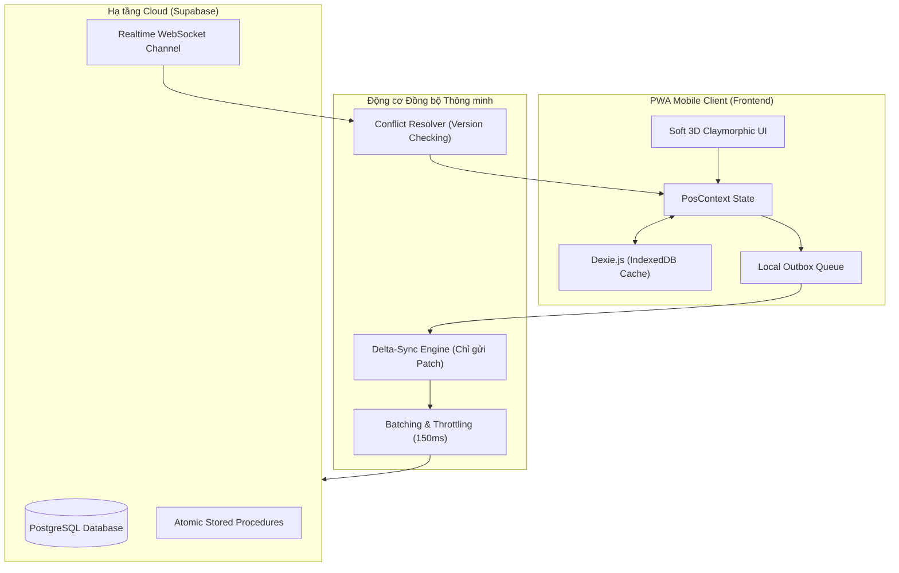
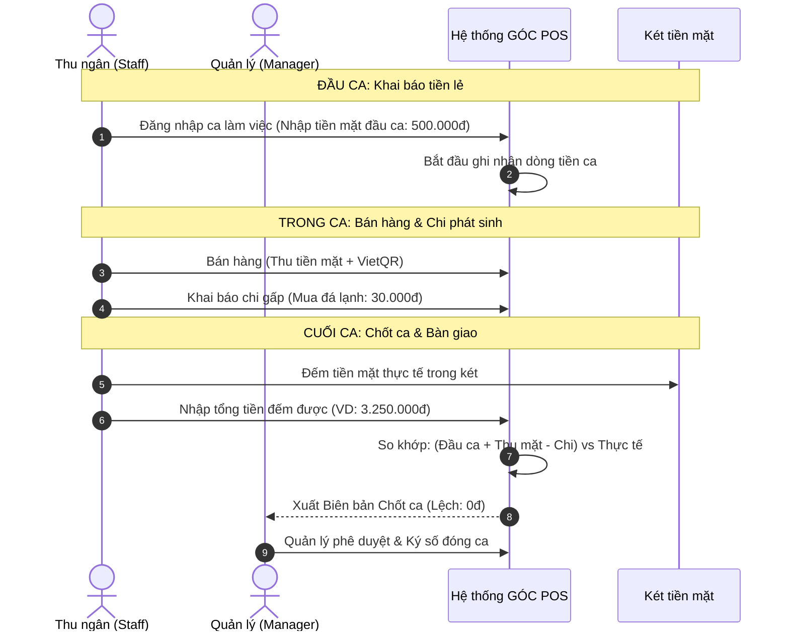
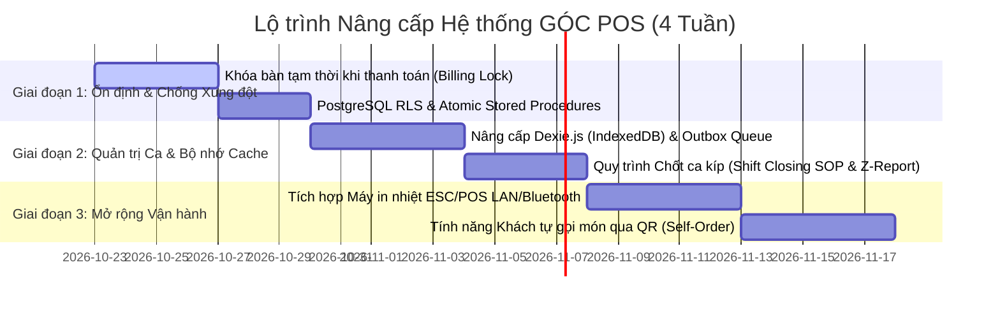

# BÁO CÁO ĐỀ XUẤT TỐI ƯU HÓA HỆ THỐNG KIẾN TRÚC & QUY TRÌNH QUẢN TRỊ VẬN HÀNH CHO GÓC POS

---

## 1. MỤC TIÊU & BỐI CẢNH (STRATEGIC OBJECTIVE)

Dự án **GÓC – Phê & Trà POS** đã đạt được bước tiến lớn sau khi hoàn tất thiết kế giao diện Soft 3D Claymorphic cao cấp, hoàn thiện logic nghiệp vụ và vượt qua bài kiểm thử mô phỏng 4 thiết bị / 30 ngày (300 đơn hàng) với độ chính xác tài chính tuyệt đối.

Để đưa ứng dụng từ trạng thái **"Sẵn sàng hoạt động" (Functional Ready)** lên tầm **"Chuẩn chuỗi thương mại cao cấp" (Enterprise Scale)**, báo cáo này đề xuất chiến lược tối ưu hóa toàn diện trên 2 phương diện:
1. **Tối ưu hóa Hệ thống Kỹ thuật (Technical & Architectural Optimization)**: Nâng cao độ bền mạng, giảm tải băng thông, tối ưu Realtime và khả năng vận hành Offline 100%.
2. **Tối ưu hóa Quy trình Quản trị & Vận hành Quán (Operational & Governance SOPs)**: Chuẩn hóa đóng mở ca, chống thất thoát tiền mặt, giải pháp in bill nhiệt tự động và mô hình tự gọi món (Self-Ordering).

---

## 2. TỐI ƯU HÓA KIẾN TRÚC KỸ THUẬT (TECHNICAL ARCHITECTURE)



---

### 2.1. Chuyển đổi từ "Document Overwrite" sang "Delta-Sync & Patch Updates"
- **Thực trạng hiện nay:**
  Mỗi khi nhân viên thêm 1 món hoặc cập nhật số lượng, ứng dụng gửi toàn bộ object đơn hàng (gồm mảng `items`, `subtotal`, `total`, `history`) lên Supabase qua lệnh `UPSERT`.
  *Hạn chế:* Tốn băng thông 4G của nhân viên, dễ gây xung đột ghi đè mất món (Lost Update) khi nhiều máy cùng thao tác.
- **Giải pháp đề xuất:**
  - Áp dụng cơ chế **Delta-Sync**: Chỉ phát đi gói tin mô tả hành động (Action Payload):
    ```json
    {
      "type": "ITEM_APPEND",
      "orderId": "ORD-123456",
      "item": { "productId": "prod-2", "name": "Cà phê Sữa", "size": "M", "quantity": 1 },
      "timestamp": 1792650000000,
      "clientId": "staff-03"
    }
    ```
  - **Throttling & Batching (150ms):** Nếu nhân viên bấm nút tăng số lượng liên tục 3 lần trong 1 giây, hệ thống tự động gom (debounce) thành 1 bản tin duy nhất trước khi phát qua WebSocket, giảm $60\%$ số lượng tin nhắn mạng.

---

### 2.2. Nâng cấp bộ nhớ đệm: Từ LocalStorage lên IndexedDB (Dexie.js)
- **Thực trạng hiện nay:**
  Dữ liệu đơn hàng, menu và lịch sử đang được lưu trữ trong `localStorage`.
  *Rủi ro:* `localStorage` đồng bộ chặn Main Thread (gây khựng UI trên máy Android yếu) và bị giới hạn trần 5MB (dễ bị đầy khi lưu lịch sử hóa đơn nhiều tháng).
- **Giải pháp đề xuất:**
  Dự án đã có sẵn thư viện `dexie: ^4.4.6` trong `package.json`. Kích hoạt cơ sở dữ liệu IndexedDB:
  ```javascript
  // src/lib/db.js
  import Dexie from 'dexie';

  export const db = new Dexie('GocPosLocalDB');
  db.version(1).stores({
    tables: 'id, status, activeOrderId',
    orders: 'id, tableId, status, businessDate, createdAt',
    orderHistory: 'id, status, businessDate, finishedAt, paymentMethod',
    payments: 'id, orderId, businessDate, paymentMethod',
    outboxQueue: '++id, actionType, payload, createdAt, status'
  });
  ```
- **Lợi ích:**
  1. Dung lượng lưu trữ mở rộng lên tới hàng trăm Megabytes (lưu trọn vẹn lịch sử cả năm).
  2. Bất đồng bộ hoàn toàn (Asynchronous), không gây đơ lag màn hình cảm ứng.

---

### 2.3. Cơ chế Ngoại tuyến Hoàn hảo (Offline-First với Outbox Replay Queue)
- **Kịch bản thực tế:** Quán bị mất mạng WiFi hoặc đường truyền Internet bị đứt cáp quang trong giờ cao điểm trưa.
- **Cơ chế Outbox Queue:**
  1. Khi mất mạng (`navigator.onLine === false` hoặc WebSocket ngắt):
     - Nhân viên vẫn mở bàn, chọn món, in tạm tính và thanh toán tiền mặt bình thường.
     - Các lệnh thay đổi được gắn cờ `status: 'pending'` và lưu vào bảng `outboxQueue` trên máy.
  2. Khi có mạng trở lại:
     - Worker ngầm tự động đẩy tuần tự các giao dịch từ `outboxQueue` lên Supabase.
     - Hệ thống sử dụng khóa định danh bất biến (`idempotencyKey`) để bảo đảm không bao giờ bị nhân đôi hóa đơn hay sai lệch kế toán.

---

## 3. TỐI ƯU HÓA QUY TRÌNH QUẢN TRỊ & VẬN HÀNH QUÁN (OPERATIONAL SOP)



---

### 3.1. Chuẩn hóa Quy trình Chốt Ca & Bàn giao Két tiền (Shift Closing SOP)
- **Thực trạng vấn đề:**
  Các quán cà phê thường xuyên gặp tình trạng cuối ngày tiền trong két không khớp với máy tính (thường thiếu từ vài chục đến vài trăm nghìn do thối nhầm tiền hoặc nhân viên tự ý lấy tiền quỹ mua đá, sữa mà quên ghi chép).
- **Quy trình chuẩn đề xuất (3 bước khép kín):**
  1. **Mở ca (Opening Shift):** Thu ngân đăng nhập, nhập "Tiền mặt đầu ca" (ví dụ: 500.000đ tiền thối có sẵn trong két).
  2. **Chi quỹ khẩn cấp (Petty Cash Expense):** Bổ sung nút *"Chi tiền mặt"* ngay trên menu quản trị (nhân viên nhập số tiền, lý do: "Mua 2 bao đá bi", chụp ảnh hóa đơn).
  3. **Chốt ca (Z-Report Closing):**
     - Thu ngân đếm toàn bộ tiền mặt có trong két và nhập vào app.
     - Công thức đối soát tự động:
       $$\text{Tiền mặt kỳ vọng} = \text{Tiền đầu ca} + \text{Tổng thu tiền mặt trong ca} - \text{Các khoản chi quỹ}$$
       $$\text{Chênh lệch} = \text{Tiền mặt thực tế đếm được} - \text{Tiền mặt kỳ vọng}$$
     - Nếu chênh lệch $\ne 0$, ứng dụng bắt buộc nhân viên ghi chú giải trình trước khi Quản lý duyệt chốt ca.

---

### 3.2. Giải pháp In Bill Nhiệt Tự động Tốc độ cao (ESC/POS Network & Bluetooth)
- **Thực trạng hiện nay:**
  App dùng lệnh `window.print()` của trình duyệt. Nhân viên phải bấm nút In, chờ popup của Windows/Android hiện lên, rồi bấm xác nhận lần nữa. Thao tác mất 5–8 giây và không tự động cắt giấy.
- **Giải pháp đề xuất:**
  - Tích hợp driver in trực tiếp chuẩn **ESC/POS** qua:
    1. **Mạng LAN / Wi-Fi (IP Printer):** Máy in bill tại quầy cắm dây mạng LAN (Port 9100). GÓC POS bắn socket TCP trực tiếp lệnh in, máy in nhả bill và tự động cắt giấy chỉ sau **0.3 giây**.
    2. **Web Bluetooth / Web Serial:** Cho phép điện thoại di động kết nối trực tiếp với máy in hóa đơn di động mini cầm tay (58mm) qua Bluetooth không cần cài driver.
  - **Tách luồng in thông minh (Split-Printing):**
    - Nhấn *"Lưu đơn"*: Tự động in Phiếu pha chế (Kitchen Ticket) tại quầy Bar chỉ gồm danh sách đồ uống, size, mức đường đá và topping.
    - Nhấn *"Thanh toán"*: In Hóa đơn thanh toán (Customer Receipt) có mã VietQR động cho khách hàng.

---

### 3.3. Mô hình Khách tự Order tại bàn (Table QR Self-Ordering)
- **Mục tiêu:** Giảm áp lực cho nhân viên vào các khung giờ cao điểm (sáng 8h-9h30 và tối 19h30-21h).
- **Mô hình triển khai:**
  1. Mỗi bàn dán 1 mã QR tĩnh dạng: `https://gocpos.vn/#/order?table=B03&mode=guest`.
  2. Khách ngồi vào bàn, quét QR bằng camera điện thoại của chính họ:
     - Giao diện thực đơn Soft 3D hiện lên mượt mà, khách tự chọn món, chọn size, mức đường/đá.
     - Khách bấm *"Gửi order"*.
  3. Máy của Thu ngân và Quản lý lập tức phát chuông chuông thông báo (sound alert) với huy hiệu: *"Bàn 03 vừa gửi order mới"*.
  4. Thu ngân chỉ cần bấm *"Chấp nhận"* -> Đơn tự động chuyển vào sơ đồ bàn và in phiếu bar.

---

## 4. MA TRẬN PHÂN QUYỀN VÀ TRÁCH NHIỆM (RACI MATRIX)

| Nghiệp vụ Quán | Nhân viên (Staff) | Cửa hàng trưởng (Manager) | Quản trị viên (Admin) |
| :--- | :---: | :---: | :---: |
| Mở bàn, chọn món, lưu đơn | **R** (Responsible) | **A** (Accountable) | **I** (Informed) |
| In tạm tính, thanh toán tiền mặt/VietQR | **R** (Responsible) | **A** (Accountable) | **I** (Informed) |
| Hủy món / Hủy hóa đơn khách đổi ý | **R** (Cần ghi lý do) | **A** (Phê duyệt nếu > 100k) | **I** (Informed) |
| Chuyển bàn, gộp bàn | **C** (Consulted) | **R / A** (Thực hiện chính) | **I** (Informed) |
| Áp dụng chiết khấu %, giảm giá VIP | **I** (Không có quyền) | **R / A** (Tối đa 20%) | **A** (Không giới hạn) |
| Thu hồi nợ đơn để qua đêm | **R** (Thu tiền) | **A** (Xác nhận gạch nợ) | **I** (Informed) |
| Chốt ca, bàn giao tiền két cuối ngày | **R** (Đếm tiền) | **A** (Kiểm tra & Ký duyệt) | **I** (Xem báo cáo Z) |
| Thay đổi giá bán thực đơn, bật/tắt món | **I** (Không có quyền) | **C** (Đề xuất) | **R / A** (Duyệt giá) |
| Thăng / hạ quyền tài khoản nhân sự | **I** (Không có quyền) | **I** (Không có quyền) | **R / A** (Toàn quyền) |
| Xóa vĩnh viễn dữ liệu bán hàng | **I** (Không có quyền) | **I** (Không có quyền) | **R / A** (Cần OTP xác thực) |

---

## 5. LỘ TRÌNH TRIỂN KHAI ĐỀ XUẤT (3 GIAI ĐOẠN)



### Chi tiết các mốc mục tiêu:
1. **Giai đoạn 1 (Tuần 1 - Nền tảng cốt lõi):**
   - Triển khai cơ chế khóa bàn khi mở modal thanh toán (`table.lock_status = 'billing'`).
   - Chạy migration DDL để kích hoạt Row Level Security (RLS) trên PostgreSQL của Supabase.
2. **Giai đoạn 2 (Tuần 2 & 3 - Tối ưu hóa vận hành & Offline):**
   - Chuyển toàn bộ dữ liệu lịch sử và đơn hàng từ `localStorage` sang `Dexie.js` (IndexedDB).
   - Bổ sung màn hình *"Chốt ca làm việc"* và biên bản đối soát tiền mặt cuối ngày cho Quản lý.
3. **Giai đoạn 3 (Tuần 4 - Tự động hóa phần cứng & Trải nghiệm khách):**
   - Tích hợp in bill nhiệt ESC/POS trực tiếp qua mạng LAN cổng 9100.
   - Thử nghiệm mô hình quét mã QR gọi món tại bàn giảm tải cho nhân viên.

---

## 6. KẾT LUẬN

Bản đề xuất này cung cấp một bức tranh kiến trúc toàn diện và lộ trình nâng cấp thực tế cho **GÓC – Phê & Trà POS**. Khi kết hợp giữa **giao diện Soft 3D hiện đại**, **nền tảng Realtime đồng bộ chuẩn xác** và **quy trình chốt ca chặt chẽ**, GÓC POS sẽ trở thành một hệ thống POS di động kiểu mẫu: vận hành mượt mà, không gián đoạn, chống thất thoát doanh thu và tối ưu hóa tối đa năng suất làm việc của nhân viên quán.
