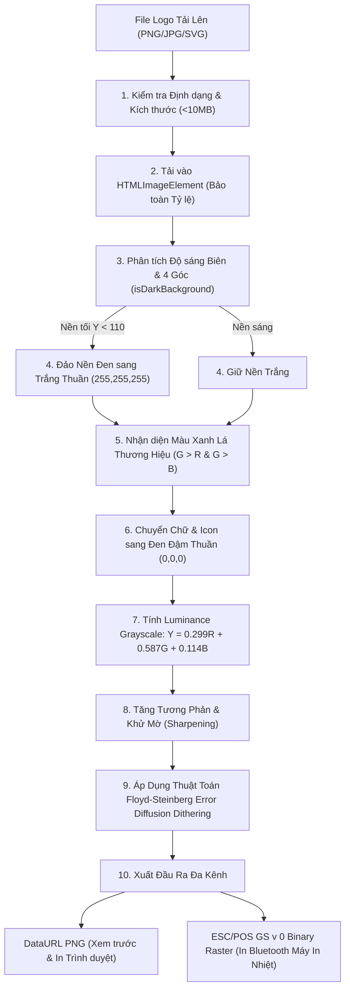

# GÓC POS — THERMAL LOGO PROCESSING
**Dự án:** GÓC – PHÊ & TRÀ POS  
**Module:** `src/utils/thermalLogoProcessor.js`

---

## 1. THÁCH THỨC VỚI LOGO MÁY IN NHIỆT

Logo thực tế của GÓC POS có nền đen, chữ xanh lá đậm thương hiệu và biểu tượng ly cà phê/trà.
Máy in nhiệt (Thermal Receipt Printer) chỉ có 2 trạng thái: **Đốt nhiệt (Đen)** hoặc **Không đốt nhiệt (Trắng)**.
Nếu gửi ảnh gốc nền đen đến máy in nhiệt thông thường:
1. Máy in sẽ đốt đen toàn bộ nền giấy, gây lãng phí nhiệt và làm kẹt/cháy giấy in bill mỏng.
2. Chữ xanh lá có độ sáng tương đương nền đen sẽ bị biến thành một vệt đen thui không thể đọc được.

---

## 2. QUY TRÌNH XỬ LÝ 10 BƯỚC TỰ ĐỘNG

Module `src/utils/thermalLogoProcessor.js` thực hiện chuỗi xử lý tự động ngay trên trình duyệt (Client-side HTML5 Canvas):

---

## 3. THUẬT TOÁN FLOYD-STEINBERG DITHERING

Khác với phương pháp ngắt ngưỡng nhị phân thô (Hard Thresholding) dễ làm mất các nét thanh mảnh của chữ "PHÊ - TRÀ" hoặc biểu tượng ly nước, thuật toán Floyd-Steinberg phân bổ sai số lượng tử hóa sang các pixel lân cận theo ma trận:

$$\begin{bmatrix}
 & * & \frac{7}{16} \\
\frac{3}{16} & \frac{5}{16} & \frac{1}{16}
\end{bmatrix}$$

- Pixel hiện tại được lượng tử hóa thành 0 (Đen) nếu $Y < 135$, hoặc 255 (Trắng) nếu $Y \ge 135$.
- Sai số $E = Y_{old} - Y_{new}$ được phân bổ:
  - Sang phải: $+ \frac{7}{16} E$
  - Xuống dưới - sang trái: $+ \frac{3}{16} E$
  - Xuống dưới: $+ \frac{5}{16} E$
  - Xuống dưới - sang phải: $+ \frac{1}{16} E$

Kết quả tạo ra bề mặt hạt mịn (stippling) mô phỏng sắc thái mà mắt người cảm nhận rất mượt mà trên giấy nhiệt 203 DPI.

---

## 4. LỆNH IN RASTER ESC/POS (`GS v 0`)

Hàm `imageToEscPosRasterBytes(imageData)` chuyển đổi ma trận điểm ảnh thành chuỗi byte nhị phân tương thích phần cứng máy in nhiệt ESC/POS:
- **Lệnh:** `0x1D 0x76 0x30 0x00` (`GS v 0 m` với $m = 0$).
- **$x_L, x_H$:** Số byte chiều ngang ($x = \lceil \text{width} / 8 \rceil$).
- **$y_L, y_H$:** Số điểm ảnh chiều dọc.
- **Dữ liệu điểm ảnh:** 1 bit ứng với 1 điểm in nhiệt ($1 = \text{đốt đen}, 0 = \text{trắng}$).
- **Cơ chế chia gói (Chunking):** Khi gửi qua Web Bluetooth, dữ liệu được chia thành các gói 100 bytes kèm khoảng nghỉ 20ms để chống tràn bộ đệm máy in (BLE buffer overrun).
